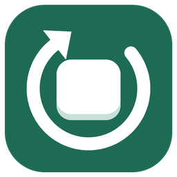

<p align="center"></p>

# KeyTapLoop — Free Auto Key Presser for Windows

It presses a key for you. Tap it every 200 ms, hold it down, send a shortcut. For 20 presses, for 10 seconds, or until you tell it to stop. That's the whole app. It's a key presser, and it isn't trying to be anything else.

I made it because the key pressers I tried either did far more than I wanted or kept the useful parts behind a paywall. This one has a handful of options, tells you what happened when it's done, and stops the moment you switch windows, so it doesn't start typing into whatever you open next.

No installer, no account, no network access, no telemetry. Windows 11, 64-bit.

## What it isn't

Not a macro recorder. No mouse clicking, no scripting, no scheduling, nothing that runs on its own. It does nothing until you press Start, and it always opens idle. If you need more than "press this key for a while", [AutoHotkey](https://www.autohotkey.com/) is the better tool.

## What you get

- Repeat a key or shortcut at a fixed interval, or hold it down.
- Stop after a number of presses, after a number of seconds, whichever comes first. Or set neither and it runs until you stop it.
- By default it's tied to one window. Switch away, even for a split second, and it ends for good. Starting again is a deliberate click. If you'd rather it type into whatever is in front, there's an **Any window** switch.
- Global shortcuts: `Ctrl + F1` starts, `Ctrl + F2` stops, `Ctrl + F3` does whichever one makes sense. Change them in **Settings**.
- Short sounds so you can tell what happened without looking: rising for start, falling for stop, a low double beep if something other than you ended the run. There's an off switch.
- Light and dark theme. It follows Windows unless you tell it not to.
- A practice pad that shows exactly which key events it received, so you aren't just taking Windows' word for it.

When a run ends it tells you why: `Completed`, `Stopped by you`, `Stopped because focus changed`, `Target closed`, or `Couldn't send input`. You also get the time and how many presses Windows accepted.

## Download

1. Grab `KeyTapLoop-v0.1.0-win-x64.zip` from [Releases](../../releases) and unzip it anywhere.
2. Optional, but worth doing: check the hash. In PowerShell:
   ```powershell
   (Get-FileHash .\KeyTapLoop-v0.1.0-win-x64.zip -Algorithm SHA256).Hash.ToLower()
   ```
   It should match the `.sha256` file on the release page. That proves you got the file I published. It doesn't prove who I am, which is what signing is for (see below).
3. Run `KeyTapLoop.exe`. It carries its own .NET, so there's nothing else to install.

## Try it in 20 seconds

1. Open KeyTapLoop and click **Use practice pad**. A second window appears.
2. Leave the key as `F`, set the count to `5`, and click **Start**.
3. After a three-second countdown, five `f` characters show up in the pad and it reports `5 tap cycles`.

Now the part I like. Set a time limit of `30` seconds, switch the count off, click **Start**, and press `Alt + Tab` after a couple of seconds. The run ends with `Stopped because focus changed`. Switch back and nothing resumes. It noticed, and it isn't going to pretend otherwise.

To use it on a real app, click **Choose window**, then switch to that app. KeyTapLoop takes whichever window is in front when its three-second countdown ends. Nothing is sent while you choose.

To start a run, either press **Start** and switch to the target during the start delay, or click into the target and press `Ctrl + F1`, which starts immediately. The delay only applies to the Start button, so set it to `0` if you always use the shortcut.

| Action | Shortcut |
| --- | --- |
| Start | `Ctrl + F1` |
| Stop | `Ctrl + F2` |
| Toggle | `Ctrl + F3` |

Each shortcut needs Ctrl, Alt or Shift, and all three have to be different. If another app already owns one, you'll be told and the old ones stay active.

## When something doesn't work

**Keys "send" but nothing happens in my app.**
Nearly always, that app is running as administrator and KeyTapLoop isn't. Windows silently blocks input from a normal app into an elevated one, and still reports success, which is the annoying part. KeyTapLoop spots the likely case and shows a **Restart as administrator** button. Only use it for software you trust. If the practice pad sees the keys, KeyTapLoop itself is fine.

**It works in Notepad but not in my game.**
Games often read the keyboard directly and ignore ordinary key events, so KeyTapLoop sends hardware scan codes by default (it's a switch in **Settings**). Some games ignore simulated input completely, and anti-cheat can block it. I can't do anything about that.

**Windows warns me before it runs.**
It's not code-signed yet, so SmartScreen will probably say so the first time. Choose **More info**, then **Run anyway**, if you trust where you got it. Or build it yourself, it's all here. Even once it's signed, a brand-new app can keep the warning until Windows has seen enough people run it.

**It stopped on its own.**
`Stopped because focus changed` means another window came to the front. That's the point of the thing. Clicking KeyTapLoop's own Stop button also counts, since clicking it moves focus. Use `Ctrl + F2` if you want `Stopped by you`.

**`Ctrl + F1` does nothing.**
Either another app owns that shortcut, or you're in chosen-window mode and the window isn't in front yet. Click it first.

**It says 20 presses but my app only reacted to some.**
"Accepted" means Windows queued the keys, not that the app did anything with them. Only the practice pad can prove a key arrived, so check the window.

## A note about games

Plenty of online games ban automated input, and their anti-cheat looks for it. KeyTapLoop doesn't claim to work with any game, and it isn't built to get around anti-cheat. If you use it somewhere that forbids automation, that's your call and your account, so don't point it at one you can't afford to lose.

<details>
<summary>How a run works, in detail</summary>

- **Period** is start to start. A 200 ms period with a 40 ms key-down time means a tap every 200 ms, and the period has to be longer than the key-down time.
- **Limits.** With a count and a time, whichever is reached first ends the run. With neither, it runs until you stop it, or until focus leaves the chosen window.
- **No catch-up bursts.** If the computer stalls, the missed taps are skipped. They aren't all fired at once afterwards.
- **Focus checks.** Right before every key-down, it checks that the chosen window still exists and is in front, and it re-checks about every 50 ms while waiting. Windows also reports focus changes, and any change ends the run. There's a tiny gap between a check and Windows delivering the key, so this makes a stray key very unlikely, not impossible.
- **Cleanup.** If a run ends while a key is down, it releases the keys it pressed, last pressed first. If Windows refuses a release, the result says so. It never takes over a key you were already holding, and it won't start if one of the keys in your shortcut is held.
- **Start shortcut released first.** When you start with a shortcut, the first key waits until you let go of it. If it's still held after 1.5 seconds, the run fails with a message.
- **How it sends keys.** The documented `SendInput` call, with normal user permissions and no drivers. It only sends to the foreground window.

</details>

## Privacy

No accounts, no telemetry, no network calls. Settings live in `%LOCALAPPDATA%\KeyTapLoop\settings.json` and hold your key, timing, shortcuts and look. It never saves a window or a running state. Delete the file to reset everything.

## Code signing

Release builds aren't signed yet. I'm applying for free code signing through the [SignPath Foundation](https://signpath.org/). If that goes through, this section will say so. The details of how signing works for this project are in [docs/CODE_SIGNING.md](docs/CODE_SIGNING.md).

## Building it yourself

You need the [.NET 10 SDK](https://dotnet.microsoft.com/download). The app builds on Windows, and the logic tests run on Linux and macOS too.

```bash
dotnet build -c Release
dotnet test
```

To make the portable build and its hash on Windows:

```powershell
./scripts/publish.ps1
```

That writes `artifacts/KeyTapLoop-v0.1.0-win-x64.zip` and a `.sha256` file next to it.

**Tests.** The run logic is tested against a fake keyboard and a virtual clock, including a few thousand randomised runs that check no key ever gets left down. None of that sends real keys. On Windows, CI also opens every window in light and dark, fails if anything paints wrong, and saves screenshots. The parts that need a real keyboard (`SendInput`, shortcuts, focus) are checked by hand, and the checklist is in [docs/TESTING.md](docs/TESTING.md).

## Maybe later

A tiny `Press` / `Wait` sequence editor, if people ask for it. A recorder, mouse support, several jobs at once, an updater: only if v0.1 turns out to be useful, and probably not even then.

## License

MIT. See [LICENSE](LICENSE).

<p align="center"><sub>Press F.</sub></p>
